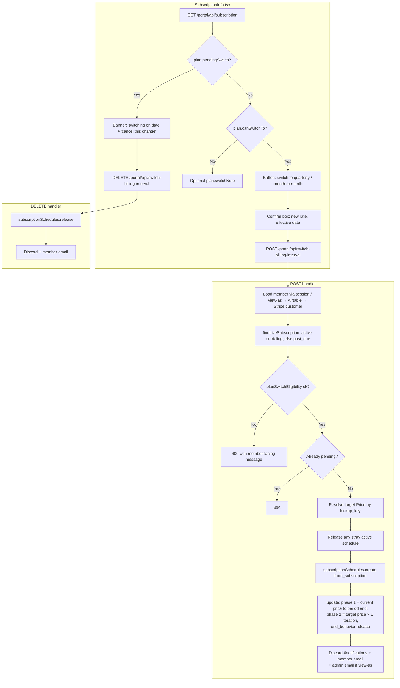

# Billing Interval Switch (monthly ⇄ quarterly)

Members on a Core or Resident subscription can move between month-to-month and
quarterly billing from the subscription card on `/portal`. The switch never
charges anyone mid-cycle: it takes effect at the end of the period they have
already paid for, and can be cancelled from the same card until then.

## Flow

## Why a Subscription Schedule

A direct `subscriptions.update` to a price with a different interval makes
Stripe reset the billing cycle and either prorate immediately or (with
proration off and the anchor unchanged) compute the next period from the
original anchor, which can leave a gap. A schedule is the documented way to
say "keep what they have until `current_period_end`, then start the new price
there". Phase 2 runs for one iteration and the schedule then releases, so the
subscription keeps renewing on the new price with no schedule attached.

Quarterly → monthly uses the same mechanism, which is what enforces the
three-month commitment: the member keeps the quarter they paid for and goes
monthly at the end of it.

## Eligibility (`app/lib/billing-interval-switch.ts`)

The portal only offers the button when all of these hold. Otherwise
`plan.switchNote` carries the reason, or is null when nothing useful can be
shown (e.g. Friend tier).

| Check | Blocked reason | Member sees |
|-------|----------------|-------------|
| Status is `active` or `trialing` | `status` | past due: settle invoice first; others: nothing |
| Exactly one item, quantity 1 | `multiple_items` | email us |
| Product is Core or Resident (`stripeProductId` in `membership-pricing.ts`) | `not_membership` | nothing |
| Price is every 1 month or every 3 months | `unknown_interval` | email us |
| Not paused (`pause_collection`) | `paused` | resume first |
| Not `cancel_at_period_end` | `cancelling` | email us |
| No discounts on the subscription | `discount` | email us (so the discount isn't lost) |

Members in their 7-day trial can switch; the trial is carried through phase 1
and the first charge at trial end is on the new price.

## Stripe side

The target price is found by lookup key (`membership_<tier>_<interval>`), the
same way `/api/membership-checkout` does, so rotating a Price needs no code
change. The schedule gets `metadata.source = portal-switch-billing-interval`
and `metadata.requested_by` for auditing in the Dashboard.

Staff can do the same thing by hand in the Dashboard (Subscription → Update
subscription → change price → "at end of current period"), and can cancel a
member's pending switch with "view as" on the portal.

## Files

- `app/lib/billing-interval-switch.ts` — pure eligibility / phase / pending-switch logic (tested)
- `app/lib/membership-plan.ts` — Stripe-backed `describePlan`, `findLiveSubscription`
- `app/portal/api/switch-billing-interval/route.ts` — POST / DELETE
- `app/portal/api/subscription/route.ts` — exposes `plan`
- `app/portal/SubscriptionInfo.tsx` — UI
