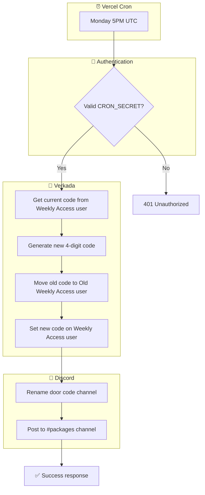
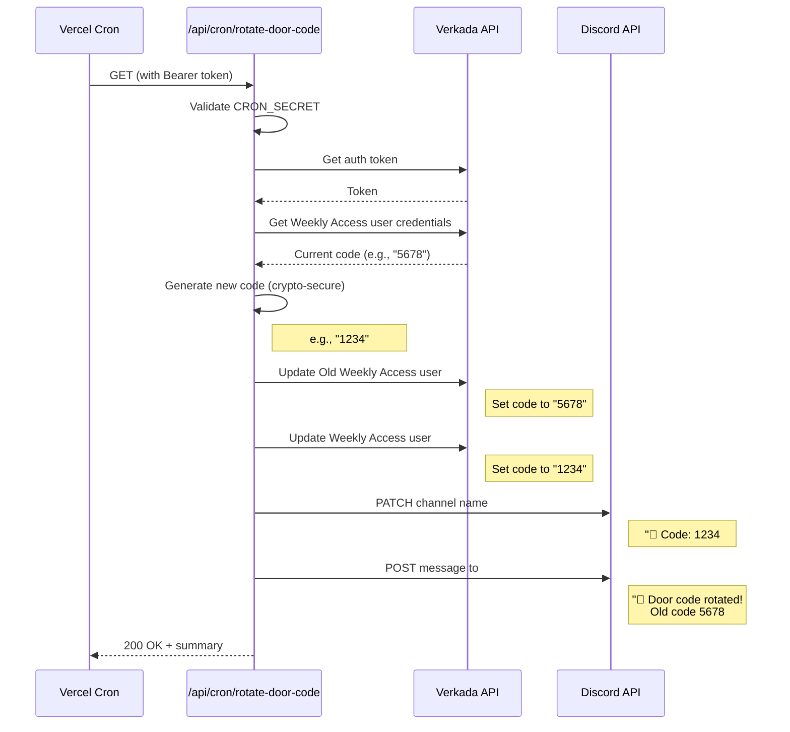
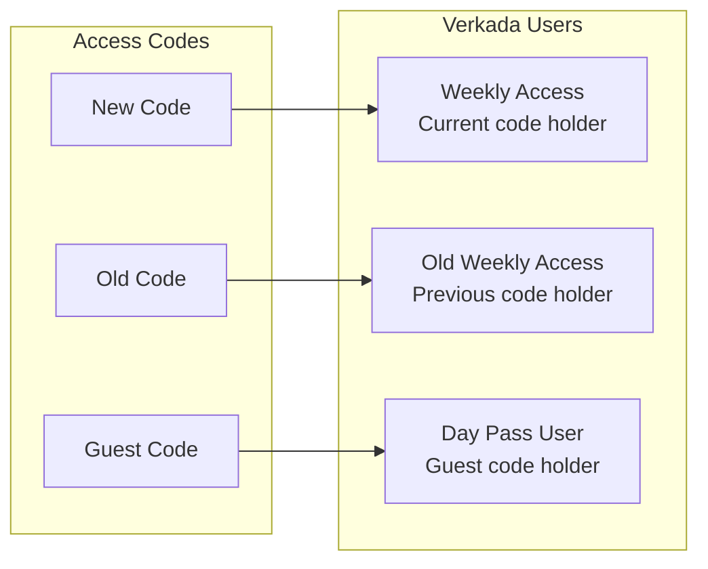
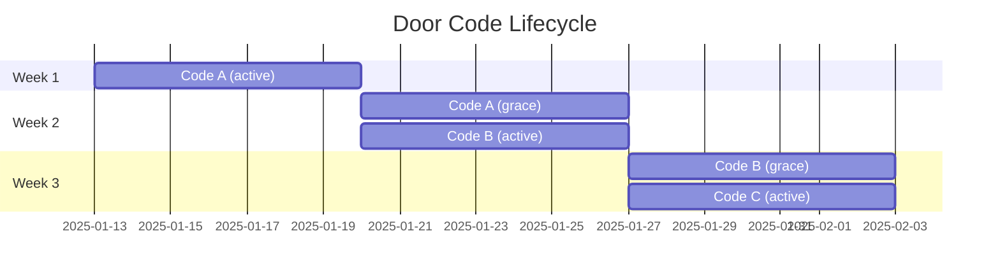

# Weekly Door Code Rotation

Automated weekly rotation of the shared door access code.

> **Status (October 2026): the shared weekly code is being deprecated.**
> Members now use their own personal Verkada PIN to get in. The member portal
> (`/portal`, door access section) shows only the personal code, generates one
> on first load if the member doesn't have one, and offers a "generate my door
> code" button if that automatic step fails. See
> [`app/portal/VerkadaPin.tsx`](../../app/portal/VerkadaPin.tsx) and
> `GET`/`POST /portal/api/verkada-pin` in [api-endpoints.md](../api-endpoints.md).
>
> The code chip in the homepage nav
> ([`app/components/PortalNav.tsx`](../../app/components/PortalNav.tsx)) also
> shows the member's personal PIN now, not the weekly code.
>
> The rotation cron below still runs, the Discord door-code channel is still
> renamed, and `GET /portal/api/weekly-door-code` still returns the current
> weekly code. Until the Verkada "Weekly Access" user is retired, the remaining
> member-facing surfaces of the weekly code are the Discord channel name and
> the `#packages` post.

## Overview



## Detailed Flow



## Verkada User Setup



## Code Validity Timeline



## Discord Updates

### Channel Rename
```
Before: 🚪 Code: 5678#
After:  🚪 Code: 1234#
```

### Notification Message
> 🔄 **Door code rotated!**
>
> The old code **5678#** will continue to work until Monday, January 27.

## Environment Variables

| Variable | Description |
|----------|-------------|
| `CRON_SECRET` | Bearer token for cron auth |
| `VERKADA_API_KEY` | Verkada API key |
| `VERKADA_MEMBER_KEY` | Token generation key |
| `VERKADA_WEEKLY_ACCESS_USER_ID` | Current code user UUID |
| `VERKADA_OLD_WEEKLY_ACCESS_USER_ID` | Old code user UUID |
| `DISCORD_DOOR_CODE_CHANNEL_ID` | Channel to rename |
| `DISCORD_PACKAGES_CHANNEL_ID` | Channel for notifications |

## Cron Configuration

In `vercel.json`:
```json
{
  "crons": [{
    "path": "/api/cron/rotate-door-code",
    "schedule": "0 17 * * 1"
  }]
}
```

Schedule: Every Monday at 5:00 PM UTC (9:00 AM PST / 10:00 AM PDT)

## Key Files

- Cron endpoint: [app/api/cron/rotate-door-code/route.ts](../../app/api/cron/rotate-door-code/route.ts)
- Discord utils: [app/lib/discord.ts](../../app/lib/discord.ts)
- Weekly code read endpoint (homepage nav only): [app/portal/api/weekly-door-code/route.ts](../../app/portal/api/weekly-door-code/route.ts)

## Personal Codes (what members use)

Each active member has their own entry code on their Verkada access user,
looked up by the email on their People record.

- Portal UI: [app/portal/VerkadaPin.tsx](../../app/portal/VerkadaPin.tsx),
  rendered in the "door access" section of [app/portal/page.tsx](../../app/portal/page.tsx)
- API: [app/portal/api/verkada-pin/route.ts](../../app/portal/api/verkada-pin/route.ts)
  — `GET` returns the code and auto-generates a 6-digit one if the Verkada
  user has none; `POST` regenerates it (blocked while staff are viewing as
  another user)
- Guest program members (`Program` / `Guest Program` tiers) share a guest code
  from [app/portal/api/verkada-guest-pin/route.ts](../../app/portal/api/verkada-guest-pin/route.ts)
  instead of a personal one
- Members whose email doesn't match a Verkada access user see the "generate my
  door code" button; if that fails too, the portal tells them to email
  team@moxsf.com so staff can create the Verkada user
