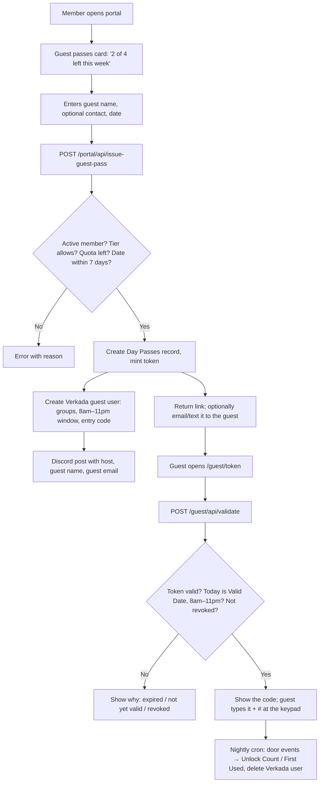

# Member-Issued Guest Passes

Members issue free, single-day guest passes from the portal. Each pass gives
the guest **their own door code** for the front door keypad, valid 8am–11pm
Pacific on the pass date and enforced by Verkada itself. Built 2026-10-14 as
an unlock link; switched to per-guest codes on 2026-11-04 when the website's
unlock buttons were removed. The "decided" and "proposed" notes further down
record how the design was settled.

## How it works now

1. The member enters the guest's name and email in the portal (and
   optionally a date up to 7 days out).
2. `POST /portal/api/guest-passes` creates a **Verkada access user** for the
   guest via the Core API (`POST /core/v1/user`, named "Priya Natarajan
   (guest of Robin)", `external_id` = `guest-pass-<token>`), adds it to the
   same access groups as the shared day-pass user (`VERKADA_UUID`), sets
   `start_date` = 8am and `end_date` = 11pm Pacific on the pass date, and
   gives it a random 6-digit `entry_code` (retrying on a clash;
   `override=false` so it never steals a member's code). Only then is the
   Airtable record written, with `Code` and `Verkada User ID`. If Airtable
   fails, the Verkada user is deleted again. A Discord #notifications post
   announces the pass (host, guest, email, date).
3. The portal shows the code next to the pass and a link
   (`moxsf.com/guest/<token>`) the member can send. The guest page shows the
   code, "followed by #", only while the pass is active; before 8am it says
   when the pass starts, after 11pm that it expired.
4. **Revoke** (`POST /portal/api/guest-passes/revoke`) deletes the Verkada
   user first, so the code dies immediately, then marks the record Revoked.
   Allowed while the pass is upcoming or active.
5. **Expiry**: Verkada refuses the code after `end_date`. The nightly cron
   `GET /api/cron/expire-guest-passes` (08:00 UTC) then reads the guest's
   door events (did they come in, when), deletes the Verkada user, clears
   `Verkada User ID`, and sets Status to Activated (used) or Expired (not
   used). The portal shows "used · arrived 1:15 PM" or "not used" the next
   day.

There is no unlock button or unlock endpoint anywhere on the site any more.
Event door links (`/door?evt=…`) only show the event and its hours.

Verkada setup needed: the API key behind `VERKADA_MEMBER_KEY` must be allowed
to create and delete users (Core API) and edit access users and groups
(Access API). `VERKADA_UUID` must point at the day-pass user whose access
groups guests should copy. Airtable needs the `Code` and `Verkada User ID`
text fields on Day Passes.

## Key files

| Piece | File |
|---|---|
| Rules: allowances, week bounds, pass window, state, Verkada naming | `app/lib/guest-passes.ts` (+ tests) |
| Airtable reads/writes, token generation, Verkada user lifecycle | `app/lib/guest-passes-server.ts` |
| Verkada API: create/delete guest users, entry codes, door events | `app/lib/verkada.ts` (+ tests) |
| Portal API: list, issue, revoke | `app/portal/api/guest-passes/route.ts`, `.../revoke/route.ts` |
| Nightly expiry cron | `app/api/cron/expire-guest-passes/route.ts` (schedule in `vercel.json`) |
| Portal card | `app/portal/GuestPasses.tsx` (rendered from `app/portal/page.tsx`) |
| Guest page | `app/guest/[token]/page.tsx` |
| Guest API: validate (returns the code while active) | `app/guest/api/validate/route.ts` |

## Design history

The rest of this doc is the original design discussion, kept for the
reasoning. Where it describes the unlock-link version, the section above wins.

Members should be able to issue a free, single-day guest pass from the portal:
the guest's access ends at the end of that day, each member gets a weekly
allowance set by their tier, and we record who the guest was.

### What existed when this was designed (Oct 2026)

| Piece | Where | Notes |
|---|---|---|
| Paid member guest pass ($25) | `app/portal/DayPassPurchase.tsx` → `POST /portal/api/create-day-pass-checkout` → Stripe webhook | Creates a People record for the guest, a Day Passes record with `Issued By`, emails the guest a magic link. |
| Guest activation | `POST /portal/api/activate-day-pass`, `/day-pass/activate` | Shows the **shared** day-pass code from the Verkada "Day Pass User" (`VERKADA_UUID`). That code is static; expiry is only tracked in Airtable, not enforced at the door. |
| Event door links | `/door?evt=<token>` → `app/door/api/validate` | A 12-char token on the Events record; the page showed an **Unlock door** button (removed 2026-11-04; it now only shows the event and hours). |
| Personal PINs | `/portal/api/verkada-pin` | Reads and sets a member's own Verkada `entry_code`. |
| Weekly code rotation | `/api/cron/rotate-door-code` | Being deprecated. |
| Check-in tracking | `/api/cron/sync-checkins` | Maps Verkada door events to People by email, writes Checkins with `Source` = Verkada / Day Pass / Manual. |
| Tier gating | `canIssueGuestDayPass()` in `app/lib/membership.ts` | Core, Resident, Private Office, Volunteer, Friend, Staff. |

Verkada API facts that matter (from apidocs.verkada.com):

- Each access user has a unique `entry_code`, plus `start_date` and `end_date`
  (Unix seconds). `PUT /access/v1/access_users/user/end_date` revokes all of a
  user's access methods after that time. We already call
  `PUT .../user/entry_code?override=true` in the rotation cron.
- `POST /access/v1/door/admin_unlock` opens a door remotely. No longer used anywhere on the site.

## Goal

1. A member opens the portal, enters a guest's name, and gets something to hand
   the guest that opens the front door **today only**.
2. Access stops at 11pm Pacific on the issue day, enforced by the system, not by
   convention.
3. Each member can issue N passes per week, where N depends on tier. Staff are
   unlimited. **Decided:** the free weekly allotment replaces the $25 purchase
   as the default; the paid pass is only offered once the week's allotment is
   used up.
4. Every pass records the host, the guest's name, when it was issued, and when
   it was first used.

## How the guest gets through the door

Two workable designs. Both share the same portal UI, quota logic, and Airtable
records; they differ only in what the guest receives.

### Option A: unlock link (shipped first, replaced 2026-11-04)

Reuse the event door-link pattern. The pass is a link like
`moxsf.com/guest/<token>`. The guest opens it at the door and taps **Unlock
door**; the server checks the token, that it's still the issue day, and that
the pass isn't revoked, then calls `admin_unlock`.

- **Verkada changes: none.** Airtable changes: a few fields (below).
- Expiry is exact and enforced server-side. Revocation is instant.
- Every unlock is logged with the guest and host names, so we can post to
  Discord and write a Checkin.
- "Single-use" becomes "one guest, one day, capped at 100 unlocks" to limit
  forwarding. Verkada can't enforce one-swipe-only for PINs either.
- Downside: the guest needs a phone with data at the door. No keypad fallback.

### Option B: per-guest expiring door code (what runs now, with one change)

Give the guest a real 6-digit code that works on the keypad. As built, there
is no fixed pool: a Verkada user is created per pass and deleted when the
pass is revoked or has expired, so there is no slot limit and door events
show the guest's own name.

- Keep a small fixed pool of Verkada access users ("Guest Pass 01" … "Guest
  Pass 20"), created once in Command and placed in the front-door access group.
  Their UUIDs live in env or a small Airtable table.
- Issuing a pass claims a free pool slot for the day, sets a fresh random
  `entry_code` (`override=true`), sets `start_date` = now and `end_date` = 11pm
  PT. Verkada enforces expiry at the door. A nightly cron frees slots and
  scrambles the codes.
- Pool size = max concurrent guest passes in one day. 20 covers a busy day;
  issuing fails gracefully when the pool is full.
- Downside: one-time Verkada setup, pool management, and door events for the
  guest show up under "Guest Pass 07" rather than the guest's name (we'd map
  them back through our own records).

Option A shipped first (2026-10-14). Option B replaced it on 2026-11-04 when
Robin decided the website should never unlock the door itself.

## Data model (Airtable)

Reuse the existing **Day Passes** table rather than adding a new one.

| Field | Change | Purpose |
|---|---|---|
| `Pass Type` | add option **Guest Pass** | Distinguishes free member-issued passes from paid ones. |
| `Guest Name` | new, text | Who the pass is for. Required. We do **not** create a People record for the guest, so the People table stays clean. |
| `Guest Email` | new, email | The guest's email, for contacting them if needed. Required. Not used to send the link. |
| `Token` | new, text | 12-char random token for the guest's link. |
| `Valid Date` | new, date | The day the pass works. Default today. The 8am–11pm window is derived in code. |
| `Code` | new, text | The guest's keypad code. |
| `Verkada User ID` | new, text | The guest's Verkada user; cleared once deleted. |
| `Unlock Count` | new, number | Accepted keypad entries, from the nightly cron. |
| `First Used` | new, dateTime | First accepted entry, from the nightly cron. |
| `Issued By Email` | new, lookup | Host's email via Issued By, so the app can filter a host's passes. |
| `Issued By`, `Status` | existing | Host; Unused / Activated / Expired / **Revoked** (new option, added by typecast). |

Weekly quota is computed, not stored: count Guest Pass records with
`Issued By` = member and `Valid Date` in the current Monday-to-Sunday Pacific
week. No new field needed.

## Flow

Portal pieces:

- A **Guest passes** section on `/portal` showing remaining passes this week,
  the list of passes issued this week with status, a **Revoke** action, and
  the issue form. The existing paid guest-pass purchase stays as the fallback
  once the free allowance is used up.
- Guest page `/guest/<token>`: Mox address, "valid today until 11pm", the
  host's first name, and the door code.

Server pieces:

- `GET`/`POST /portal/api/guest-passes` (member auth, quota and tier checks)
  and `POST /portal/api/guest-passes/revoke`.
- `POST /guest/api/validate` (public, token-gated, throttled per IP) returns
  the code while the pass is active. Issuing a pass posts to Discord
  #notifications with the host, guest name and guest email; no Attendance
  record is written, since guests have no People record.
- Quota rules in `app/lib/guest-passes.ts` with unit tests, next to
  `membership.ts`.

## Weekly allowance by tier

**Decided:** allowances are per week, not per day. The week runs Monday 00:00
to Sunday 23:59 Pacific. Proposed numbers (Austin's mockup):

| Tier | Passes per week |
|---|---|
| Core | 2 |
| Resident | 4 |
| Private Office | 6 per person |
| Volunteer | 2 (same as Core, since volunteers hold a Core membership) |
| Program / Guest Program / Friend | 0 (can still buy the $25 pass) |
| Staff | unlimited |

The pricing table's "Guest passes" row (`app/components/MembershipPricingTable.tsx`)
and the join FAQ guest-policy paragraph (`app/join/page.tsx`) currently say
1/day and 2/day; both change to the per-week numbers as part of this work.

## Copy (decided 2026-10-14)

Portal card:

- Heading: **guest passes**
- Intro: "bring a friend for the day." then "**2 of 4 left this week** · resets monday"
- Fields: "guest's name", "guest's email"; button: "create pass"
- Helper: "valid today, 8am–11pm. click button to generate a code."
- Each live pass shows "door code 482913#", the link, copy link, and revoke.
- Over quota: "you've used this week's 4 passes. more on monday." followed by
  "need one sooner? buy a day pass for your guest ($25)." and the existing
  purchase form.
- Empty name: the button does nothing and an inline error appears under the
  field: "enter your guest's name". The API also rejects a blank name (400),
  so the check doesn't depend on the browser.

Guest page:

- "Robin invited you to **Mox**", then a green block: "Pass for Priya
  Natarajan" / "Valid today until 11pm"
- "Your door code" / "482913#", then "1680 Mission St, San Francisco. Enter
  the code on the keypad at the front door, followed by #." and "This code
  is yours for today only and stops working at 11pm."; footnote: "Sign in at
  the lobby when you arrive."
- Expired: "This pass expired" / "It was valid on Oct 14." / "Check with
  Robin for a new one." (the host's first name, never Mox staff)

Guest contact: **Decided (revised 2026-10-15):** name and email are both
required, so Mox can reach a guest if needed. We still don't email the guest;
the member copies the link and sends it themselves. No People record is
created for the guest.

## Remaining decisions and proposed defaults

1. **Link or code first?** Link shipped first; codes replaced it on
   2026-11-04 (see top of this doc).
2. **Future-dated passes:** proposed: allow a Valid Date up to 7 days out,
   default today. A future-dated pass counts against the week it's valid in.
4. **Hours:** proposed: valid from 8am to 11pm Pacific on the Valid Date, so a
   link can't open the door in the middle of the night.
5. **Over-quota behavior:** **Decided:** show the existing $25 purchase form
   with a note that this week's allotment is used up.
6. **Private Office allowance:** proposed: per person, counted against the
   individual member who issues the pass.
7. **Revocation:** the host can revoke from the portal; staff can revoke any
   pass. **Decided (2026-10-27):** only unused passes can be revoked.
   **Revised (2026-11-04):** with codes we don't know live whether the guest
   has come in, so a pass can be revoked any time before 11pm on its day
   (revoking deletes the code). It still counts against the week's allowance.

## Rough effort

- Option A end to end: about a day of work, plus Airtable field creation.
- Option B on top of A: another day. Done without a pool (one Verkada user per
  pass). Verkada's docs say entry codes are 4–16 digits and unique per
  organization; the first real pass should be issued with a staff account to
  confirm the create / group / start-end / entry-code calls against the live
  API, since none of this can run locally.
