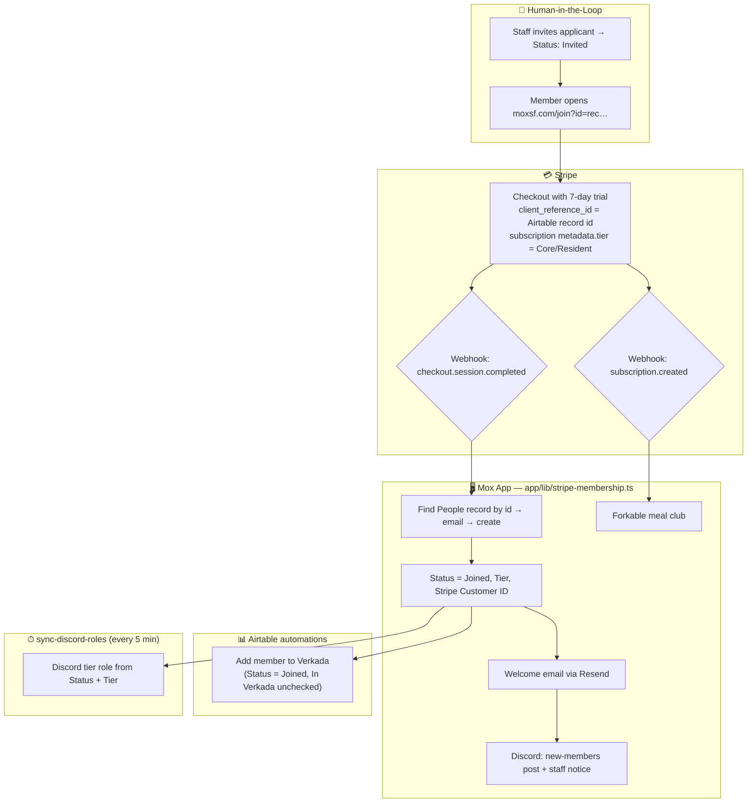

# Member Onboarding Workflow

This documents the complete flow from new member signup through active subscription, and what happens when a membership lapses.

## Overview

## Membership Lifecycle (Stripe webhook)

`app/api/webhooks/stripe/route.ts` dispatches to `app/lib/stripe-membership.ts`.
This replaced the Zapier Zap "On new Mox subscription, ping Discord & update
Airtable", which mapped the subscription's price *amount* to a tier through a
Zapier Table and silently skipped the Airtable update whenever a price it did
not know was used (which is what happened when prices changed on 2026-10-14).
The Zap should stay **off**; with both running, members would get two welcome
emails.

| Stripe event | What the app does |
|--------------|-------------------|
| `checkout.session.completed`, mode `subscription` | Tier from `subscription.metadata.tier` (set by `/api/membership-checkout`), else from the Product. Finds the People record by `client_reference_id`, then by email, else creates one. Sets `Status=Joined`, `Tier`, `Stripe Customer ID`. Sends the welcome email (`app/lib/emails/membership-welcome.ts`). Posts to Discord `#new-members` and the staff notifications channel. Idempotent: a record that already shows this customer as Joined with this tier is left alone and nothing is re-sent. |
| `customer.subscription.created` | Adds Core/Resident members to the Forkable meal club (best effort, see below). |
| `invoice.payment_failed` | Staff Discord heads-up with amount, attempt number and Stripe's next retry date. **No access change**: Stripe's Smart Retries usually recover these within a week. |
| `customer.subscription.updated`, `past_due → unpaid` | Stripe exhausted its retries. `Status=Payment Issue`, `In Verkada` unchecked, member removed from the Verkada access group. Portal door code and guest passes stop (they require `Joined`); the Discord role drops on the next sync. |
| `customer.subscription.updated`, `unpaid`/`past_due → active` | If the record is `Payment Issue`, back to `Joined`. The Airtable Verkada automation re-provisions door access because `In Verkada` is unchecked. |
| `customer.subscription.deleted` | `Status=Cancelled`, door access removed, as above. Skipped if the customer still has another live subscription (plan switches). |

**Stripe settings this relies on:** the webhook endpoint must be subscribed to
all five events above, and under Billing → Subscriptions → Manage failed
payments, choose *mark the subscription as unpaid* (not cancel) after the final
retry, so a card update resumes the same subscription.

**Failure handling.** Every handler is idempotent. If one throws (Airtable or
Resend down, unknown data), the route returns 500 so Stripe retries for up to
three days, and posts a 🚨 alert to the staff Discord channel with the event
id. Because the welcome email is sent before the Airtable write, a retry after
a failed write can send a second email; a paying member is never left
un-Joined. Lapse handlers report a failed Verkada removal in the Discord
notice rather than failing, since Airtable is the source of truth for access.

**Known gaps.** Members who pause through the portal are handled by the
`pause-subscription` route and the "On subscription paused" Zap, not here.
Office and program members never touch Stripe; their onboarding is the
Airtable "Auto-Onboarding" automation on the Office & Program Onboarding form.

## Pricing and Checkout

Membership prices live in `app/lib/membership-pricing.ts` and are rendered by
`app/components/MembershipPricingTable.tsx` on `/join` (invited visitors) and
`/portal/renew` (lapsed members). Each tier has a quarterly rate (billed every
3 months up front) and a month-to-month rate; the table toggles between them.

Clicking a tier calls `POST /api/membership-checkout`, which finds the Stripe
Price by `lookup_key` and opens Stripe Checkout with a 7-day trial. The lookup
keys must exist on active Prices under the existing membership Products so the
webhook's product → tier mapping below keeps working:

| Lookup key | Product | Amount |
|------------|---------|--------|
| `membership_core_quarterly` | prod_RpkYg9EMJoi5oi (Core) | $1,350 every 3 months |
| `membership_core_monthly` | prod_RpkYg9EMJoi5oi (Core) | $595 monthly |
| `membership_resident_quarterly` | prod_RpkufjD9E3esG5 (Resident) | $2,550 every 3 months |
| `membership_resident_monthly` | prod_RpkufjD9E3esG5 (Resident) | $995 monthly |

To change a price: create the new Price in Stripe, move the lookup key to it,
and update the amount in `membership-pricing.ts` so the table matches. The
checkout route logs a warning if the two ever disagree.

Private offices are quoted by hand (the Office column links to email).

## Tier to Forkable Club Mapping

### Via Stripe (subscription purchase)

| Stripe Product | Airtable Tier | Forkable Club |
|----------------|---------------|---------------|
| prod_RpkYg9EMJoi5oi | Core | MOX_MEMBERS |
| prod_RpkufjD9E3esG5 | Resident | MOX_RESIDENTS |
| prod_Rq9VzfM9QoJwPD | Friend | None |

### Via Airtable Automation (non-Stripe members)

| Airtable Tier | Forkable Club |
|---------------|---------------|
| Private Office | MOX_RESIDENTS |
| Program | MOX_MEMBERS |

See [forkable-tier-sync.md](./forkable-tier-sync.md) for Airtable automation setup.

Stripe product IDs and Forkable club IDs are configured in the webhook handler and forkable.ts.

## Notification Emails

**To: team@moxsf.com**

Success:
> Subject: Forkable: {name} added successfully
>
> {name} ({email}) has been added to {clubName}.
> They will receive an invitation from Forkable.

Failure:
> Subject: Forkable: Failed to add {name}
>
> Error adding {name} ({email}) to Forkable: {error}
> Please add them manually.

## Key Files

- Webhook handler: [app/api/webhooks/stripe/route.ts](../../app/api/webhooks/stripe/route.ts)
- Forkable client: [app/lib/forkable.ts](../../app/lib/forkable.ts)
