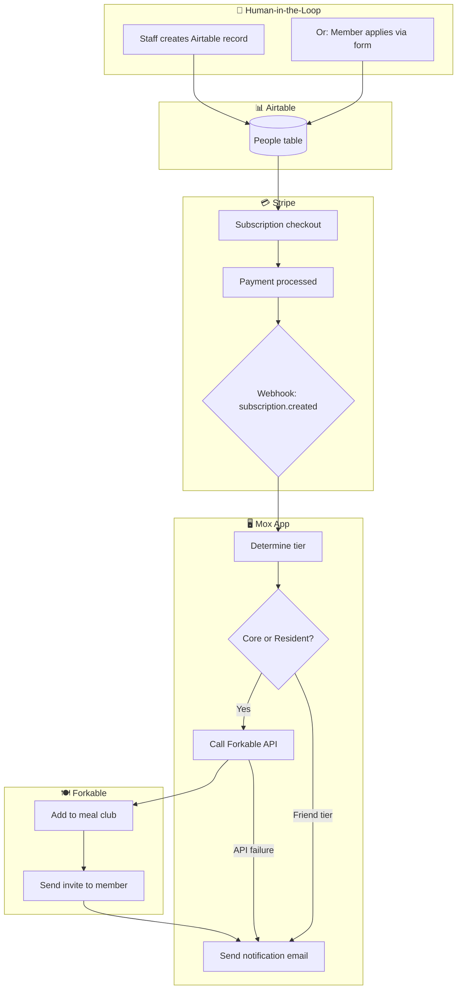

# Member Onboarding Workflow

This documents the complete flow from new member signup through active subscription.

## Overview

## Pricing and Checkout

Membership prices live in `app/lib/membership-pricing.ts` and are rendered by
`app/components/MembershipPricingTable.tsx` on `/join` (invited visitors) and
`/renew` (lapsed members). Each tier has a quarterly rate (billed every
3 months up front) and a month-to-month rate; the table toggles between them.

Clicking a tier calls `POST /api/membership-checkout`, which finds the Stripe
Price by `lookup_key` and opens Stripe Checkout with a 7-day trial. The lookup
keys must exist on active Prices under the existing membership Products so the
webhook's product → tier mapping below keeps working:

| Lookup key | Product | Amount |
|------------|---------|--------|
| `membership_core_quarterly` | prod_RpkYg9EMJoi5oi (Core) | $1,350 every 3 months |
| `membership_core_monthly` | prod_RpkYg9EMJoi5oi (Core) | $595 monthly |
| `membership_resident_quarterly` | prod_RpkufjD9E3esG5 (Resident) | $2,550 every 3 months |
| `membership_resident_monthly` | prod_RpkufjD9E3esG5 (Resident) | $995 monthly |

To change a price: create the new Price in Stripe, move the lookup key to it,
and update the amount in `membership-pricing.ts` so the table matches. The
checkout route logs a warning if the two ever disagree.

Private offices are quoted by hand (the Office column links to email).

## Join Links

`/join` shows one of these, depending on the URL:

| URL | Shows |
|-----|-------|
| `/join?id=rec…` (the People "Join link" field) | The invite page with checkout buttons, if the record's Status is Invited, To Invite, Cancelled or **Joined** and the person holds no membership subscription in Stripe |
| same, but they already pay | "You're already a member" with a button to the Stripe billing portal, where they change tier |
| same, but the record is missing or has another Status | "We couldn't find your invite", with an email to ask for a fresh link |
| `/join?invite=friend-of-mythos` | The invite page with checkout buttons, no Airtable record |
| `/join` | The public page; tier buttons go to the application form |

Joined is allowed so people who came in through a program (Tier Program) or
were marked Joined by hand can start a paid membership from the same link.
After checkout the Stripe webhook marks them Joined and sets their Tier from
the product they chose (see `docs/workflows/stripe-airtable-sync.md`).
There is no name gate: the record ID in the link identifies the person, and
`/portal` links invited and cancelled members to `/join?id=<their record>`.

Existing members can move between the two intervals from the portal; see
`docs/workflows/billing-interval-switch.md`.

## Tier to Forkable Club Mapping

### Via Stripe (subscription purchase)

| Stripe Product | Airtable Tier | Forkable Club |
|----------------|---------------|---------------|
| prod_RpkYg9EMJoi5oi | Core | MOX_MEMBERS |
| prod_RpkufjD9E3esG5 | Resident | MOX_RESIDENTS |
| prod_Rq9VzfM9QoJwPD | Friend | None |

### Via Airtable Automation (non-Stripe members)

| Airtable Tier | Forkable Club |
|---------------|---------------|
| Private Office | MOX_RESIDENTS |
| Program | MOX_MEMBERS |

See [forkable-tier-sync.md](./forkable-tier-sync.md) for Airtable automation setup.

Stripe product IDs and Forkable club IDs are configured in the webhook handler and forkable.ts.

## Notification Emails

**To: team@moxsf.com**

Success:
> Subject: Forkable: {name} added successfully
>
> {name} ({email}) has been added to {clubName}.
> They will receive an invitation from Forkable.

Failure:
> Subject: Forkable: Failed to add {name}
>
> Error adding {name} ({email}) to Forkable: {error}
> Please add them manually.

## Key Files

- Webhook handler: [app/api/webhooks/stripe/route.ts](../../app/api/webhooks/stripe/route.ts)
- Forkable client: [app/lib/forkable.ts](../../app/lib/forkable.ts)
