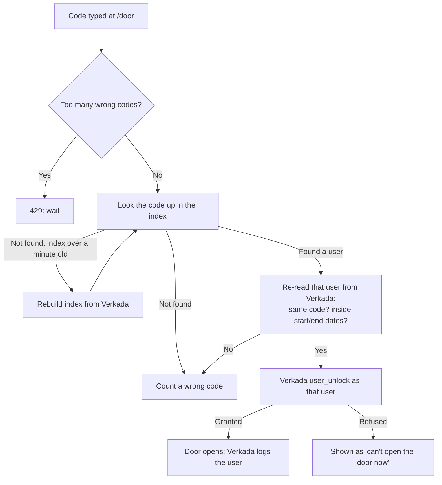

# Web Door Keypad (`/door`)

`moxsf.com/door` is a keypad in the browser. Anyone can type a Verkada entry
code there, and a code that is valid right now opens the front door. It stands
in for the hardware keypad at the door.

It accepts whatever Verkada accepts: a member's personal code, a guest pass
code, the shared weekly code, a code set by hand in Verkada Command. There is
no separate list of codes on our side.

(`/door?evt=...` is unrelated: that is the event page, which shows an event's
name and hours and has no unlock.)

## How a code becomes an unlock

- **Finding the owner.** Verkada has no "who owns this code" lookup; a code
  can only be read one user at a time. `app/lib/door-pins.ts` keeps an index
  of every access user's code, built by listing all access users and reading
  each one. The index holds keyed hashes, not the codes, and lives in the
  Vercel Runtime Cache (`app/lib/door-store.ts`) so all function instances
  share it.
- **The index is only a shortcut.** Before every unlock the matched user is
  read from Verkada again, and the live code and start/end dates must match.
  A changed, revoked or expired code is refused even if the index still
  lists it.
- **New codes.** A code newer than the index is not found at first. A miss
  rebuilds the index (at most once a minute), so a just-issued code works on
  the first try but takes a few seconds longer. A successful unlock on an
  index older than five minutes refreshes it in the background.
- **The unlock.** `POST /access/v1/door/user_unlock` with the user's id.
  Verkada decides whether that user may open that door (access groups and
  schedules), so a guest code outside pass hours is refused by Verkada.

## Tracking who came in

Each unlock appears in Verkada Command's access log as **Access Granted**,
method **User Unlock API**, against the access user who owns the code. That
is the same log keypad entries go to, so the nightly `sync-checkins` cron and
the guest-pass usage counts pick these up like any other entry.

Wrong codes never reach Verkada. They are in the function logs as
`[door-unlock]` lines (address and outcome, never the code).

## Wrong-code limits

The page is public, so guessing has to be slow (`app/lib/door-throttle.ts`).
Only wrong codes count.

| Limit | Threshold | Effect |
|-------|-----------|--------|
| Per address | 5 wrong in 10 minutes | That address waits out the 10 minutes |
| Everyone combined | 20 wrong in 10 minutes | Keypad closed to all for 30 minutes; post in Discord #notifications |

While the keypad is closed, signed-in members can still use the unlock button
in the portal.

## Requirements in Verkada

- **Enable Door Management via API** switched on at the organization, the
  site, and the front door (Command > Access). Without it Verkada refuses
  every API unlock.
- The API key (`VERKADA_MEMBER_KEY`, falling back to `VERKADA_API_KEY`) needs
  Access Control read/write, as for the portal's door code.
- The door id is `MOX_FRONT_DOOR_ID` in `app/lib/verkada.ts`.

## Files

- `app/door/page.tsx`, `app/door/DoorKeypad.tsx`: the page
- `app/door/api/unlock/route.ts`: the endpoint
- `app/lib/door-pins.ts`: code index and live check
- `app/lib/door-throttle.ts`: wrong-code limits
- `app/lib/door-store.ts`: shared store (Vercel Runtime Cache)
- `app/lib/verkada.ts`: `userUnlockDoor`, `listAccessUsers`, `getAccessUserCredentials`
